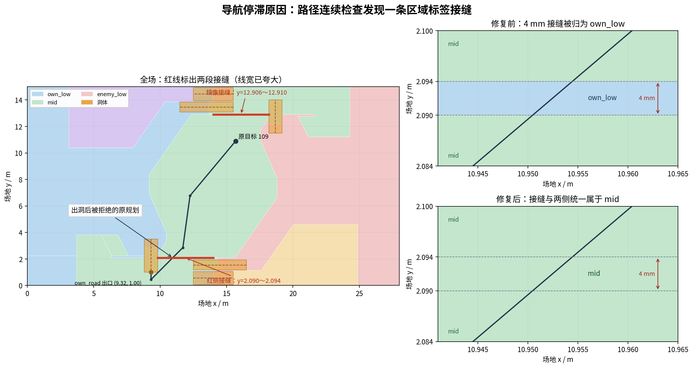

# 出洞后普通导航停滞：区域接缝修复

2026-11-03 单哨兵演示 `runs/bbt_feature_demo_20261103` 在 own_road_tunnel 成功穿越后停止。第21.9秒出口Action成功，第22.8秒提交普通目标109；59次目标都有规划结果，但出洞后的路径均未进入FollowPath。

根因在 `decision.yaml` 的区域划分。Arena道路边缘与中央坡面边缘相差4毫米，剩余地面被划入低地区域，夹在两块mid之间。该条带是地面上的区域标签接缝，不是墙缝、洞口净宽或机器人尺寸问题。

| 场地坐标范围（m） | 修复前 | 修复后 |
|---|---|---|
| x=9.82～14，y=2.090～2.094 | own_low | mid |
| x=14～18.18，y=12.906～12.910 | enemy_low | mid |

原规划从 `(9.32,0.45)` 到 `(11.716,2.86)`，约在 `(10.952,2.092)` 穿过第一条接缝。终点属于mid，生产 `segment_within_region` 检查整个线段，因此正确拒绝中途穿过own_low的路径。旧演示直接执行目标，没有走当前规划审核链，不能证明原区域配置符合当前契约。

修复将上述两条接缝归入mid。其余区域、39点、六洞几何和安全门禁保留；邻近10毫米低地小单元仍按原规则判断。回归通过生产配置和公开几何接口验证红蓝部署的原始失败路径、镜像接缝、相邻低地区域、共享边界及未授权穿洞。将修复前配置临时用于同一测试可复现失败，恢复修复配置后通过。

三包构建成功，10项CTest全部通过，28个tools Python脚本编译通过。独立Spec审查无发现；Standards审查发现测试中的负下标风险，已增加非负检查并复验。

修复后重跑 `runs/bbt_feature_demo_navfix_20261103`：300秒演示16/16通过。第24.7秒接续普通FollowPath，记录24条导航任务、322发实际射击；第265.1秒到达操作手原坐标。6000个物理tick、1501帧确定性回放通过。配置SHA256为 `245f29da4089f80365d515dd672496ebb782a7e86f04a4e9922d6cee4eb68c71`，决策节点SHA256为 `cfb595a869a0ad39bfceaa01bef311a191cb659d0c40a78e0e040a5bdac1a955`。

证据为运行目录内的 `validation.json`、`result.json`、`source_manifest.json`、`red/interfaces.jsonl` 和 `replay_verification.json`。runs仍由Git忽略；演示工具的清单不是六洞构建收据。这次演示在60秒改变前哨控制权，未模拟前哨建筑被摧毁。红蓝部署已通过几何回归，本轮完整物理演示只跑红方。
